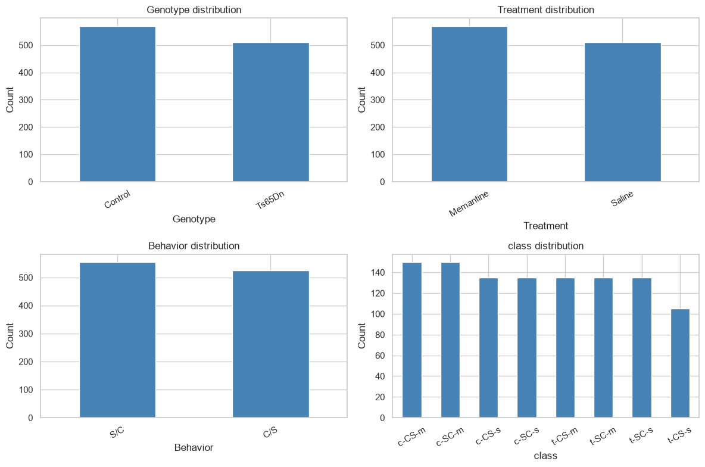
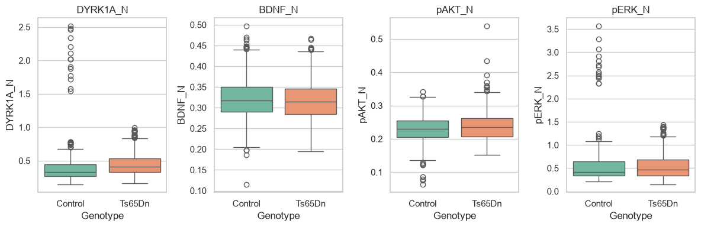
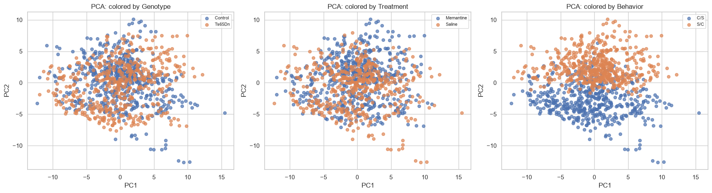
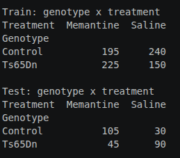
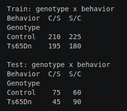
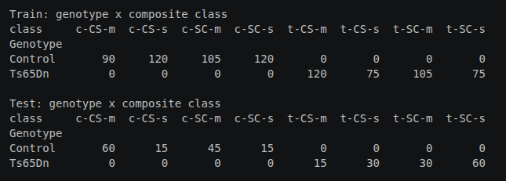
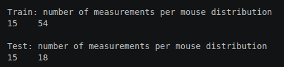
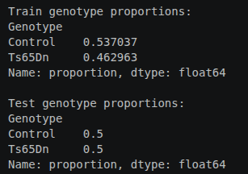

# Practical 1 report: preparing biological data for machine learning

**Student:** [Uliana Krektun] 
**Date:** [29/09/26]  
**Practical:** 1 - Data to ML-ready format

## How to use this template

Replace the text in square brackets with your own answers. Include figures and tables where requested. Every result should be accompanied by one or two sentences explaining what it means biologically and what decision it supports.
## 1. Executive summary

In 150-250 words, summarize:

- the biological question 
- the dataset or datasets used 
- the main preparation decisions 
- the most important data-quality issue 
- the final train/test design 
- one limitation that affects interpretation.

[The biological question here is whether protein-expression patterns distinguish genotype (control versus trisomy). For this purpose the Mice Protein Expression dataset is used (Data_Cortex_Nuclear.xls). The biological unit is the mouse (mouse_id derived from MouseID). Predictors are the 77 proteins, class (which encodes genotype) and identifiers were excluded to prevent leakage. Missing values were median-imputed, fitted on training data only, since complete-case removal discards 528 rows (about half of the data). The missingness is unequal: more missing values for measurments 13-15 (the biggest dillution, so probably coulld be 0), but the difference is not very big, so we cannot change all NA to 0. Rows are repeated measures, not independent samples, this is why the group-aware split was used: GroupShuffleSplit by mouse_id (75/25, seed 42). A key limitation is that treatment is confounded with genotype in opposite directions in train and test (Memantine: Control 45% vs 78%, Ts65Dn 60% vs 33%), and behavior strongly shapes protein profiles, so results from the 18-mouse test set may partly reflect these design factors.]

## 2. Data-preparation readiness

Complete this section before describing modelling results.

## Scientific purpose and provenance

- [X] Is the biological question and prediction task stated clearly?
- [X] Is the unit of observation clear (for example, patient, tissue, cell, mouse, or technical measurement)?
- [X] Have I recorded the data version, processing history, and transformations already applied?

## Table shape and identifiers

- [X] Is the table tidy: one observation per row, one variable per column, and one value per cell?
- [X] If the original assay has features in rows and samples in columns, have I transposed it into the format expected by the analysis tool?
- [X] Are row names, column names, and identifiers clear, unique, stable, and free from accidental index columns?
- [X] Can every feature and observation be traced back to its source?
- [X] Are the feature matrix and metadata aligned by an explicit identifier rather than by row order?

## Types, values, and measurement meaning

- [X] Are numerical, categorical, ordinal, text, date, and identifier columns correctly classified?
- [X] Are units, scales, encodings, reference categories, and detection limits understood?
- [X] Have I checked impossible values, inconsistent labels, unexpected categories, constant features, and extreme values?
- [X] Are normalization, scaling, log transformation, and batch-correction steps documented?

## Missing values

- [X] Have I detected missing values using the dataset's actual missing-value representations, not only `NaN`?
- [X] Have I measured missingness by row, column, group, and relevant batch or time variable?
- [X] Do I know whether missingness is structural, technical, or plausibly related to the biology or target?
- [X] Have I justified whether to retain, remove, or impute missing values?
- [X] If imputing, will the imputer be fitted on training data only and then applied to validation/test data?

## Replicates, dependence, and grouping

- [X] Have I checked for exact duplicates and near-duplicate observations?
- [X] Are observations biological replicates, technical replicates, repeated measurements, pseudo-replicates, or independent samples?
- [X] Is the independent biological unit identified by a grouping variable?
- [X] Will all related observations and their derivatives remain in the same train/validation/test split?
- [X] If I created augmented or synthetic observations, is their provenance recorded and reproducible?

## Target, leakage, and study design

- [X] Is the target defined before modelling, with its classes or values checked for balance and validity?
- [X] Have I excluded identifiers, post-outcome variables, duplicated target information, and other leakage sources from the features?
- [X] Have I identified batch, site, plate, subject, cohort, treatment, sex, age, time, or other possible confounders?
- [X] Have I checked whether the target is associated with a technical or grouping variable?
- [X] Does the planned split represent the biological generalization question?

## Reproducibility and decision record

- [X] Are random seeds, software versions, file names, and input/output shapes recorded?
- [X] Are all preprocessing steps placed in a reproducible pipeline?
- [X] Have I recorded unresolved data-quality concerns and the decisions made about them?
- [X] Can another person explain what each row, column, feature, target, and grouping variable means?

### 3.1 Data presentation

Describe:
- what one row represents 
- what one biological mouse represents 
- `MouseID` and derived `mouse_id` 
- `Genotype`, `Treatment`, `Behavior`, and `class` 
- the prediction target selected.

**Answers:**  
[Each row represents one protein-measurment record from a mouse. One biological mouse represents one biological unit that is named as mouse_id. Original MouseID represents mouse_id plus number of record, because for each mouse 15 measurement were made. 
The eight classes of mice are described based on features such as genotype, behavior and treatment. According to genotype, mice can be control or trisomic (Down syndrome). According to behavior, some mice have been stimulated to learn (context-shock) and others have not (shock-context). Some mice have been injected with saline and others with memantine (Treatment column).
Classes:
c-CS-s: control mice, stimulated to learn, injected with saline
c-CS-m: control mice, stimulated to learn, injected with memantine
c-SC-s: control mice, not stimulated to learn, injected with saline
c-SC-m: control mice, not stimulated to learn, injected with memantine

t-CS-s: trisomy mice, stimulated to learn, injected with saline
t-CS-m: trisomy mice, stimulated to learn, injected with memantine
t-SC-s: trisomy mice, not stimulated to learn, injected with saline
t-SC-m: trisomy mice, not stimulated to learn, injected with memantine
The selected prediction target is genotype.
The structure of the dataset: 1,080 rows, 72 mice × 15 measurements, and 82 columns, MouseID, 77 protein levels plus Genotype, Treatment, Behavior and class.]

Explain the structure of the dataset

### 3.2 Tidy-data assessment and EDA

Report:
- rows and columns: `[rows, columns: (1080, 83)-after adding mouse_id column]` 
- unique mice: `[72]` 
- measurements per mouse: `[15]` 
- categories and counts for Genotype, Treatment, Behavior, and class: `[Counts for Genotype: 'Control': 570, 'Ts65Dn': 510
Counts for Treatment: 'Memantine': 570, 'Saline': 510
Counts for Behavior: 'S/C': 555, 'C/S': 525
Counts for class: 'c-CS-m': 150, 'c-SC-m': 150, 'c-CS-s': 135, 'c-SC-s': 135, 't-CS-m': 135, 't-SC-m': 135, 't-SC-s': 135, 't-CS-s': 105]` 
- whether the table is tidy: `[Yes, because each protein (variable) forms a column, while each row represents a single observation and each cell contains a single, unique value]`.

Include at least three plots. For each, state the biological question it addresses.

Plot1: represent the distributions for each group. So the question is the dataset is balanced between different categories (genotype, treatment, behaviour and class)?

Plot2: Boxplots of DYRK1A, BDNF, pAKT, pERK by genotype. The question is do individual proteins differ between Ts65Dn and control mice? (these proteins are example proteins with biological relevance)

Plot3: PCA colored by genotype, treatment and behavior. Question: which experimental factor dominates the global protein profile? On the plot we can see that Behaviour make the visible separation into 2 groups.

### 3.3 Diagnostics

Report checks for:
- missingness in proteins and metadata: `[Total missing protein values: 1396
Total missing metadata values: 0]` 
- duplicate rows or duplicate measurement identifiers: `[Duplicate MouseID values: 0
Rows with identical protein values: 0]` 
- expected 15 measurements per mouse: `[All mice have exactly 15 measurements]` 
- unusual categories or inconsistent labels: `[-]` 
- non-finite, negative, or implausible expression values: `[Infinite values in protein columns: 0
Negative expression values: 1. This negative value was treated as missing value before median imputation]` 
- highly correlated or redundant protein variables: `[Highly correlated pairs (>0.95): 3
ARC_N     pS6_N      1.000000
DYRK1A_N  BRAF_N     0.959578
          ITSN1_N    0.959512]` 
- predictors that are deterministic parts of the target: `['class' column is a direct predictor (it has the genotype information inside labels), this why this column excluded from the predictors, as well as other non-protein columns. The candidate predictors are the 77 protein measurements]`.

### 3.4 Preparation and feature roles

Selected supervised-learning question: can the 77 protein expression levels predict genotype in unseen mice?

Missing-value decision: median imputation, fitted on the training data only and applied to the test data. 
Rows with complete protein data: 552
Rows discarded under complete-case rule: 528
So almost half of the samples would be removed if we take the removal strategy. More missing values are found for the samples 13-15 (the largest dillution), do probably we could impute 0 values, but still many NA found in other dillutions, so I decided that median would be a better choice.

### 3.5 Split strategy
- Independent biological unit: `[mouse]`
- Grouping variable: `[mouse_id]`
- Split method: `[group-aware split, 
splitter = GroupShuffleSplit(n_splits=1, test_size=0.25, random_state=42)
train_idx, test_idx = next(splitter.split(X, y, groups=mice['mouse_id']))]`

### 3.6 Confounding and distribution structure

Investigate associations between the target and:
- treatment 
- behavior 
- genotype 
- composite class 
- number of measurements per mouse.

The association reverses between splits. Model could learn the treatment signal instead of genotype.

Here the distribution more uneven in test than in train. Also the behaviour is the main driver of PC2.

Composite class encodes the target (as well as treatment and behaviour), the class mix differs between splits.

Number of measurments per mouse is constant (15)

Genotype classes are good balanced.

## References and reproducibility
Together with this report you need to provide
- notebook 
- data files
- generated plots
